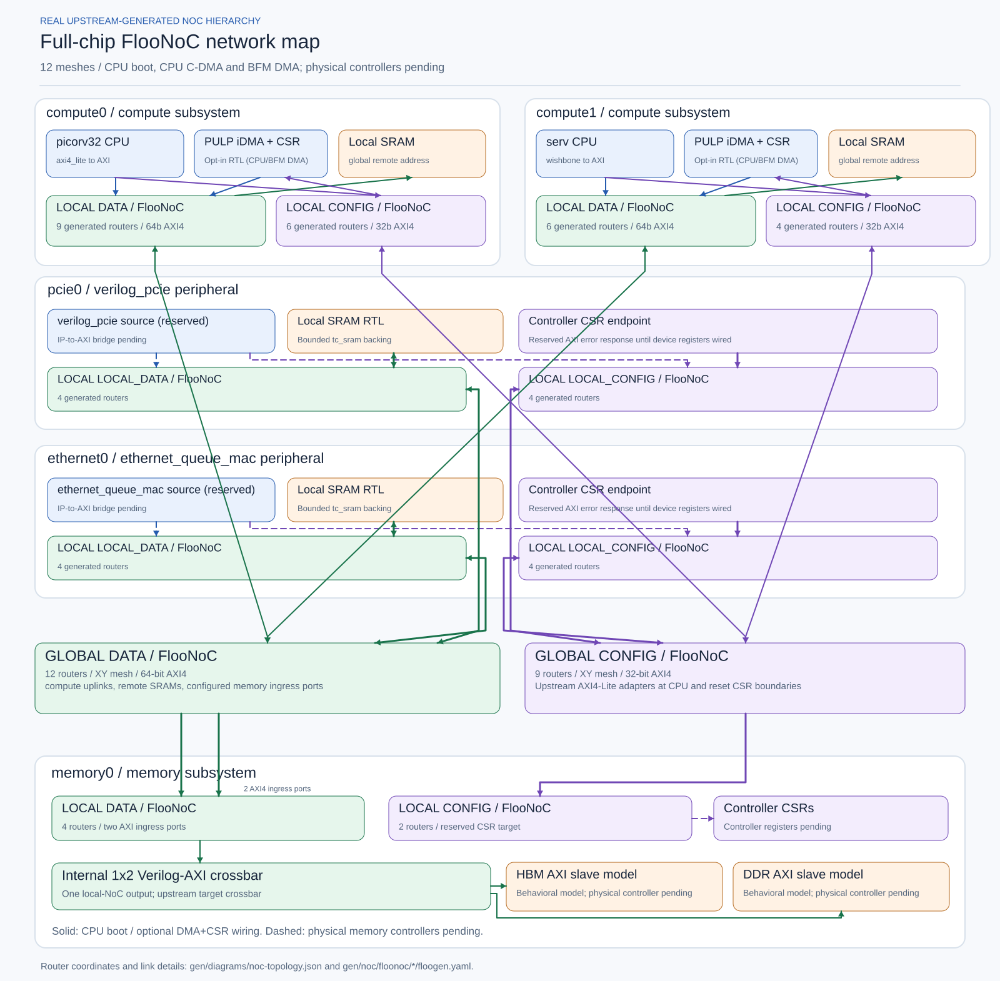

# Config-driven SoC RTL and verification with Xezim

[](https://github.com/r987r/xezim-hello-world/actions/workflows/dv-soc.yml)

A reusable, **configuration-driven hierarchical SoC test vehicle** built from publicly available RTL. One `config/soc.yaml` selects compute subsystems, CPU IP, reserved DMA interfaces, memory targets, data/config NoCs, addresses, and verification scopes. The same configuration generates **SystemVerilog testbench code, NoC connectivity metadata, executable test plans, 2D diagrams, and this README's architecture section**. Both PULP iDMA engines and their CSR bridges are generated in the explicit `DmaEnable=1` mode; the default cold-boot mode keeps them disabled. The **full-chip DMA RTL path passed**: SS0/SS1 descriptor chains, 32-bit CSR doorbells, real data/config FlooNoCs, memory-model readback and completion checks in [CI run 41885417960](https://github.com/r987r/xezim-hello-world/actions/runs/41885417960). This is the CPU0-AXI-BFM-assisted DMA-only scope. **Real CPU0 C firmware has now independently launched and checked DMA** through the same NoCs ([CI 41933332567](https://github.com/r987r/xezim-hello-world/actions/runs/41933332567)); DDR/HBM remain behavioral models.

The [GitHub Pages verification hub](https://r987r.github.io/xezim-hello-world/)
publishes this README, all documentation, the canonical topology and actual CI
test results with tested commits, logs and AXI traffic reports.
See [publication and retention](docs/publication.md).

**Review every test's stimulus without digging through scripts:**
[human-authored YAML stimulus catalog](config/stimulus/tests.yaml) ·
[how specs map to drivers and selected plans](config/stimulus/README.md) ·
[build/simulator regression selection](config/regression.yaml).
Run `python3 tools/stimulus_catalog.py --list` or
`python3 tools/stimulus_catalog.py --show chip-ethernet-cpu` to inspect any target.
Descriptions for legacy tests are **not** claims that the common scenario
executor already dispatches their internal C/Python/SV actions.

## Opt-in real LiteDRAM full-chip milestone (November 6, 2026)

**Merged [DDR-B PR #74](https://github.com/r987r/xezim-hello-world/pull/74)** into `main` at [`d6f9612`](https://github.com/r987r/xezim-hello-world/commit/d6f9612a1a391593630ba49ba5384c3866faaf1a). The final exact-PR-head real-controller CPU/iDMA and routed negative RTL passed in [DDR-B CI #42246102337](https://github.com/r987r/xezim-hello-world/actions/runs/42246102337) at `026cd1f0a14930253df27afb6c9f3a834a67f72b`. The opt-in `chip-ddr4-real` variant connects the Memory0 crossbar to **pinned LiteDRAM RTL** behind a guarded 64→25-bit AXI adapter, initializes controller CSRs through the independent 16-KiB Config NoC and Wishbone path, and executes compiled PicoRV32/PULP iDMA SRAM→DDR→SRAM with real readback checks. Required evidence includes complete INIT/RUN/CHECK, matching controller AXI AW/B and AR/RLAST, DFI reads/writes, behavioral bank writes, and passive NoC traffic capture.

**New routed protection verification passed at the same tested SHA:** after CPU CHECK, an RTL-gated verification AXI master exclusively assumes the compute0 DMA NoC port, issues write/read at `0x142001000` (32 MiB beyond the modeled backing of `0x140001000`), requires both responses to be `DECERR`, verifies zero forbidden controller AW/AR forwarding, and confirms the original in-range data remains unchanged. The [final source-matched workflow](https://github.com/r987r/xezim-hello-world/actions/runs/42246102337) checks this evidence JSON, not just a simulator zero exit.

**Scope and follow-on verification:** default boot, PCIe and Ethernet variants retain fast behavioral AXI memory targets. `chip-ddr4-real` uses behavioral SDRAMPHYModel/BankModel, **not** an electrical DDR4 PHY. Ethernet/PCIe packet traffic against *real DDR* remains follow-on integration under [epic #34](https://github.com/r987r/xezim-hello-world/issues/34). The [final full-chip boot CI #42246102437](https://github.com/r987r/xezim-hello-world/actions/runs/42246102437) passed CPU C/iDMA, dual-DMA, cold boot, named boot-negative and Xezim compile with report artifacts. Its prior 45-minute timeout was fixed by the merged 65-minute job budget. The checked-in topology remains the **default** modeled-memory configuration; the exact opt-in generated RTL, NoC and controller reports are preserved as CI artifacts. [DDR-B issue #40](https://github.com/r987r/xezim-hello-world/issues/40) is closed for initial controller integration; stress/refresh and cross-protocol interoperability remain separate.

## Initial PCIe0 + CPU iDMA + modeled-DDR↔host integration

**Functional RTL path validated** in [PCIe CI #42134213227](https://github.com/r987r/xezim-hello-world/actions/runs/42134213227)
(PR [#60](https://github.com/r987r/xezim-hello-world/pull/60)).
One real CPU0 C program configures PULP iDMA through the generated
configuration NoC. Data moves in both directions between modeled DDR and
PCIe0 SRAM over live data NoCs; a modeled PCIe host sends and reads 64-byte
vectors through the real upstream TLP→AXI bridge. Its report records 27
successful INIT/RUN/CHECK steps, 3,741 matched read/completion TLP pairs,
8 posted write TLPs, 47,864 completed AXI transactions, no correlation
issues and 130.083 ns average accepted TLP read latency at the real bridge
boundary. See [full evidence and limits](docs/pcie0-host-phases.md).

The PCIe path is currently **host-BAR pull, not endpoint-initiated DMA into
host DRAM**. The PCIe test uses a modeled AXI SRAM DDR target, not the opt-in real LiteDRAM controller.
Combined Ethernet+CPU+PCIe host traffic, Ethernet/PCIe access to real DDR, outbound host DMA, physical PHY, backpressure and performance qualification remain separate gates.
Generated topology diagrams and RTL continue to be governed by `make gen`;
this status section does not override the source-true variant manifest.

## Ethernet0 minimal viable IP: generated-chip GMII RX/TX now passing

[Merged PR #73](https://github.com/r987r/xezim-hello-world/pull/73) contains a single real 1G GMII MAC, RX and TX queues, descriptor and packet AXI DMA, B-gated completion records, one six-initiator upstream PULP AXI mux into Ethernet local Data NoC and an independent Config NoC AXI4-to-Lite queue CSR target. [CI #42145885849](https://github.com/r987r/xezim-hello-world/actions/runs/42145885849) passed the opt-in generated-chip RX into SRAM and **modeled** DDR plus TX from both memories, with exact bytes/FCS and CQ frontdoor readback. The test uses CPU0 AXI BFMs with the real CPUs held reset.

**Ethernet standalone MVP is verified.** [Exact-head CI #42162107273](https://github.com/r987r/xezim-hello-world/actions/runs/42162107273) passed four dedicated jobs, including a **real PicoRV32 CPU0 C** program that configures Ethernet RX/TX queue CSR/policy through Config NoC, writes SRAM descriptors/data, validates 85 received bytes, B-gated RX/TX CQ records and IRQ acknowledgement, while a physical GMII test peer transmits and receives byte-perfect frames. CPU0 is not replaced by an AXI BFM in that test. Merged NoC fix [#78](https://github.com/r987r/xezim-hello-world/pull/78) resolves the earlier same-ID response assertion. The default generated chip and canonical architecture diagram intentionally keep Ethernet reserved; only `ethernet_mode=True` instantiates live Ethernet. See [Ethernet #64 closure](docs/ethernet0-closure-gate.md) and [full integration #34](docs/multiprotocol-integration-readiness.md): cross-protocol PCIe host visibility and five combined `StepRecorder` steps are **not** Ethernet MVP merge blockers.

## Architecture, real RTL connectivity, and verification

<!-- BEGIN GENERATED SOC -->

<!-- Do not edit this section: regenerate with `make gen`. -->
### Whole-SoC data and configuration NoCs

The **single architecture diagram** below includes all local/global FlooNoCs, compute CPU/DMA/SRAM blocks and memory target crossbar. It is generated from the same SoC configuration and FlooGen endpoint topology as the real structural RTL. **Solid links show generated optional iDMA/CSR wiring (enabled in DMA mode); dashed links show pending physical controllers.** The same NoC RTL serves cold boot, CPU0 C-launched DMA, and dual-engine BFM DMA.

[](gen/diagrams/noc-hierarchy.svg)

[Full-size diagram](gen/diagrams/noc-hierarchy.svg) · [Editable Mermaid](gen/diagrams/noc-hierarchy.mmd) · [Machine-readable router/NI/link graph](gen/diagrams/noc-topology.json) · [Real generated FlooNoC RTL](gen/noc/floonoc/manifest.json)

**Configured topology:** 2 compute subsystems, 12 independent FlooNoC instances, 68 total generated routers. Data: 64-bit AXI4; control: 32-bit AXI4 transport for AXI4-Lite endpoint bridges. CPU/reset adapters are attached in the boot configuration; the BFM scope uses AXI agents.

**Verification truth:** Xezim exercises separate CPU cold-boot/SRAM and Verilog-AXI memory testbenches. Both Xezim and Verilator have compiled the eight structural FlooNoCs. The unified `make dv-supernoc` regression connects all meshes to upstream AXI agents and checks destinations, data, bursts, concurrent IDs, stalls and downstream SLVERR. Xezim NoC traffic is not verified. The `make dv-chip` boot configuration runs the real CPUs through the shared NoCs with CPU0-coordinated init/run/check and AXI memory stand-ins. The `make dv-chip-cpu-dma` variant also runs compiled C on real CPU0 to submit DMA through the configuration NoC, roundtrip DDR/HBM data, and compare actual CPU allocations with the Python plan (verified in CI run 41933332567). `make dv-chip-dma` independently tests both real engines with CPUs held in reset and BFM-initialized DMA SRAM. See [chip boot scope](docs/full-chip-boot.md) and [DMA integration](docs/dma-bringup.md).

### Generated NoC sources (no duplicate pictures)

| Network | Routers | Generated top | Config |
| --- | ---: | --- | --- |
| `compute0_local_config` | 6 | [SystemVerilog](gen/noc/floonoc/compute0/local_config/floo_xezim_compute0_local_config_noc.sv) | [FlooGen YAML](gen/noc/floonoc/compute0/local_config/floogen.yaml) |
| `compute0_local_data` | 9 | [SystemVerilog](gen/noc/floonoc/compute0/local_data/floo_xezim_compute0_local_data_noc.sv) | [FlooGen YAML](gen/noc/floonoc/compute0/local_data/floogen.yaml) |
| `compute1_local_config` | 4 | [SystemVerilog](gen/noc/floonoc/compute1/local_config/floo_xezim_compute1_local_config_noc.sv) | [FlooGen YAML](gen/noc/floonoc/compute1/local_config/floogen.yaml) |
| `compute1_local_data` | 6 | [SystemVerilog](gen/noc/floonoc/compute1/local_data/floo_xezim_compute1_local_data_noc.sv) | [FlooGen YAML](gen/noc/floonoc/compute1/local_data/floogen.yaml) |
| `ethernet0_local_config` | 4 | [SystemVerilog](gen/noc/floonoc/ethernet0/local_config/floo_xezim_ethernet0_local_config_noc.sv) | [FlooGen YAML](gen/noc/floonoc/ethernet0/local_config/floogen.yaml) |
| `ethernet0_local_data` | 4 | [SystemVerilog](gen/noc/floonoc/ethernet0/local_data/floo_xezim_ethernet0_local_data_noc.sv) | [FlooGen YAML](gen/noc/floonoc/ethernet0/local_data/floogen.yaml) |
| `global_config` | 9 | [SystemVerilog](gen/noc/floonoc/global_config/floo_xezim_global_config_noc.sv) | [FlooGen YAML](gen/noc/floonoc/global_config/floogen.yaml) |
| `global_data` | 12 | [SystemVerilog](gen/noc/floonoc/global_data/floo_xezim_global_data_noc.sv) | [FlooGen YAML](gen/noc/floonoc/global_data/floogen.yaml) |
| `memory0_local_config` | 2 | [SystemVerilog](gen/noc/floonoc/memory0/local_config/floo_xezim_memory0_local_config_noc.sv) | [FlooGen YAML](gen/noc/floonoc/memory0/local_config/floogen.yaml) |
| `memory0_local_data` | 4 | [SystemVerilog](gen/noc/floonoc/memory0/local_data/floo_xezim_memory0_local_data_noc.sv) | [FlooGen YAML](gen/noc/floonoc/memory0/local_data/floogen.yaml) |
| `pcie0_local_config` | 4 | [SystemVerilog](gen/noc/floonoc/pcie0/local_config/floo_xezim_pcie0_local_config_noc.sv) | [FlooGen YAML](gen/noc/floonoc/pcie0/local_config/floogen.yaml) |
| `pcie0_local_data` | 4 | [SystemVerilog](gen/noc/floonoc/pcie0/local_data/floo_xezim_pcie0_local_data_noc.sv) | [FlooGen YAML](gen/noc/floonoc/pcie0/local_data/floogen.yaml) |

**Validation and generated metadata:** [NoC interface budgets](config/interface_contracts.yaml) · [routing IR](gen/noc/fabric_ir.json) · [memory testbench](gen/memory/memory_tb.sv) · [verification plan](gen/verification/plan.json) · [generated tree manifest](gen/manifest.json).

<!-- END GENERATED SOC -->

## Current implementation status and agent runbook

**Working today:** Xezim executes real PicoRV32/SERV cold boot and the
open-source 2x2 Verilog-AXI memory crossbar (full and sparse routing).
**All eight local/global FlooNoC structural RTL modules are generated
and checked in**, and Verilator has independently elaborated all eight
using pinned upstream Bender dependencies. The generated `supernoc_tb`
connects all eight through eleven AXI4 links with six upstream managers
and nine mapped sparse BFM targets. `make dv-supernoc` checks routed
traffic; see [coverage and results](docs/supernoc-verification.md).
**Chip boot configuration:** `gen/chip/soc_top.sv` adds real CPU/SRAM/reset
attachments, upstream WB/AXI/width adapters, and a memory target crossbar
with AXI slave stand-ins. `make dv-chip` checks CPU0-coordinated init/run/check.
**New optional DMA mode:** `DmaEnable=1` generates PULP iDMA engines at
each compute local data NoC and 32-bit CSR doorbells at each local
configuration NoC. `make dv-chip-dma` is a separate hardware gate with
CPUs held in reset; it passed the end-to-end NoC RTL regression at [commit d2868045](https://github.com/r987r/xezim-hello-world/commit/d2868045b7d8ba3b6a687f9639efea1d5c87af9a). **Now verified:** CPU0-initiated C DMA with SRAM/DDR/HBM allocation and roundtrip checks. **Still pending:** CPU interrupt-service
firmware, real HBM/DDR controllers/PHY.
See [full-chip boot](docs/full-chip-boot.md) for the precise scope.

For source-backed maturity and outstanding work, see
[implementation status](docs/implementation-status.md); the single diagram
above is the only generated SoC architecture picture.
Future coding agents **must** follow [AGENTS.md](AGENTS.md), including pinned
Xezim binary installation, `make gen`, `make check-generated`, the full
YAML-defined regression, including both AXI routing profiles. Never hand-edit
`gen/` or silently replace a missing upstream backend.

## View real generated FlooNoC Verilog

The tracked `gen/noc/floonoc/` directory holds **eight upstream
FlooGen-generated router/chimney structural SystemVerilog tops, typed
packages, exact generated configuration profiles, and a source manifest**.
They are regenerated by `make gen` from the SoC YAML and the native
interface sizing contracts, and verified by `make check-generated`. The
[full network diagram](gen/diagrams/noc-hierarchy.svg) and
[Diagram-gen-compatible connectivity metadata](gen/diagrams/noc-topology.json)
come from the same generated FlooGen mesh configurations, not a second
hand-maintained topology.
The upstream FlooNoC/AXI/common_cells libraries are not copied into
`gen/`; they are resolved from pinned sources. **Generated != elaborated
or traffic-tested**. For AXI-Lite control networks, reuse the real PULP
AXI adapters documented in
[AXI-Lite-over-FlooNoC](docs/axi-lite-over-floonoc.md). Both
**Verilator 5.020 and pinned Xezim compile all eight generated NoCs**,
but Xezim reports width warnings in the four data meshes. The
[simulator compatibility audit](docs/simulator-compatibility.md)
records these; compilation is not routed-traffic verification.

## FlooNoC fabric policy

All **local data/config** and **global data/config** NoCs use pinned upstream
FlooNoC, with independent mesh instances. Inside memory0, the verified
Verilog-AXI target crossbar is attached downstream of the memory-local NoC
in the chip boot configuration, with AXI slave memory stand-ins. Its older
2×2 stress test and the BFM-only `supernoc_tb` remain independent scopes.
AXI4-Lite control endpoints need real upstream AXI-Lite/AXI4 adapters.
All eight local/global FlooGen outputs are generated and reviewable in
`gen/noc/floonoc/`. One [whole-chip picture](gen/diagrams/noc-hierarchy.svg)
and its router/NI JSON cover the hierarchy; there are no separate mesh images.
The connected BFM regression is distinct from real endpoint integration.

## Explicit interface sizing

[AXI interface budgets](config/interface_contracts.yaml) and the
[contract checker](tools/interface_contracts.py) now validate named local
and global subsystem fabric ports, 64-bit AXI4 data/address, configured
local AXI ID widths (4-bit input, 5-bit output), independent pending
read/write targets, and native IP parameter names. This is a validated
**design contract**. Native chimney parameters are bound in generated RTL,
and directed traffic passes; maximum capacity and every parameter combination
remain unverified. CI keeps FlooGen AXI widths and memory windows in sync.

## Subsystem-level tests and FlooNoC bring-up

Use [subsystem verification plan](docs/subsystem-verification.md) as the
authoritative scope definition (compute0, compute1, memory0, global data,
global config, full SoC). [All eight generated FlooNoC topologies](gen/noc/floonoc/manifest.json)
are committed actual upstream-generated SystemVerilog, with the connected NoC BFM regression described in
[super-NoC verification](docs/supernoc-verification.md).
No bridge- or simulator-repro TB proliferation.

## Build and regression

[`Bender.yml`](Bender.yml) defines standard ordered source sets;
[`config/regression.yaml`](config/regression.yaml) defines tests, variants
and suites shared by Make and CI. `make test-list` lists the catalog;
`make test` runs every declared simulation and compatibility probe using
both toolchains. [Setup, filelists, build/run stages and results](docs/regression.md)
replace the old per-test shell runners. Cold boot includes a relocated-map
regression driven by the generated boot configuration package.

The NoC and chip cocotb runs also produce a [per-test AXI run report](docs/axi-run-reports.md):
an offline HTML page with a filterable transaction table and completion
timeline, plus raw events/transaction JSON. Dedicated CI artifacts retain
the pages for positive and negative runs. The Pages hub collects their full CI
evidence after main workflows finish. New reports label real CPU/BFM/idle actors,
show phase markers, and distinguish explicitly expected SLVERR requests from
undeclared initiator errors. Normal CPU boot does not expect SLVERR; error-path
tests deliberately inject target faults or exceed the 64-KiB memory models.

## Reproducible generation

Everything under **[`gen/`](gen/)** is committed to Git for version-to-version diffs. The directory is exclusively generator-owned and contains a marker protecting against accidental replacement of user-owned trees.

```bash
python3 -m pip install -r requirements.txt
python3 tools/ip_fetch.py floonoc
python3 -m pip install -e .tools/floonoc
make gen                 # regenerate code, metadata, diagrams, README
make check-generated     # non-mutating drift and stale-file check
make check-config        # generator/config test suite
```

`make gen` builds all outputs in a staging directory before replacing the complete `gen/` tree. **Obsolete generated files are removed** when a block, network, subsystem, or diagram disappears from YAML. No file outside `gen/` is deleted; only the explicitly marked README section is rewritten. `make check-generated` compares both file *names* and bytes, so CI catches missing, modified, and stale files without committing or modifying anything. Generation does not depend on a GPU, web service, 3D viewer, or Graphviz: the README embeds static **2D architecture SVG**, with Mermaid source alongside for editing and review.

The generated artifacts include:

| Output | Purpose |
| --- | --- |
| [`gen/memory/memory_tb.sv`](gen/memory/memory_tb.sv) | Real synthesizable crossbar instantiated in a generated AXI memory testbench |
| [`gen/memory/manifest.json`](gen/memory/manifest.json) | Bus parameters, instance metadata, memory models, tests |
| [`gen/noc/fabric_ir.json`](gen/noc/fabric_ir.json) | Vendor-neutral NoC/interconnect intermediate representation |
| [`gen/verification/plan.json`](gen/verification/plan.json) | Verification scopes, executable vs planned boundaries, test commands |
| [`gen/verification/routes.json`](gen/verification/routes.json) | Source/target AXI reachability expectations for the executable memory test |
| [`gen/diagrams/`](gen/diagrams/) | One SVG, its Mermaid source and structured router/NI graph (`noc-topology.json`) |
| [`gen/manifest.json`](gen/manifest.json) | Deterministic SHA-256 index of every generated output |

The static SVG previews display directly in GitHub README and mobile clients, even when Mermaid rendering is unavailable. Each has a full-resolution link; the `.mmd` sources and structured graph metadata remain committed for diffs.

The 2D visualizations follow the instance/connection metadata ideas in [Sv-diagrams](https://github.com/r987r/Sv-diagrams) and [Diagram-gen](https://github.com/r987r/Diagram-gen); verification scope metadata follows the YAML testbench pattern in [Sv-test](https://github.com/r987r/Sv-test). There is **no 3D dependency** and no duplication of architecture definitions in the diagram sources.

## Running the verification checks

The regression reuses the pinned Xezim executable; it does **not** rebuild Rust or Xezim for source or configuration changes. Third-party RTL is fetched at locked commits on first use.

```bash
make gen
XEZIM_BIN=/path/to/xezim make dv-memory
XEZIM_BIN=/path/to/xezim make dv-memory-negative
XEZIM_BIN=/path/to/xezim make dv-cpu     # request-only diagnostic
XEZIM_BIN=/path/to/xezim make dv-serv    # four-word SERV image; checked signature store
XEZIM_BIN=/path/to/xezim make dv-sram    # real RTL SRAM, no power-on preload
XEZIM_BIN=/path/to/xezim make dv-boot    # real ROM->SRAM CPU execution
XEZIM_BIN=/path/to/xezim make test
make dv-supernoc                    # independent NoC BFM regression
make dv-chip                        # real CPU boot + independent DMA NoC gate
make dv-chip-dma                    # real SS0/SS1 DMA+CSR across data/config NoCs
make dv-chip-cpu-dma                # compiled C on real CPU0; same boot checker + DMA
# CPU C DMA gate passed at 573dc871; future changes still require exact-head CI.
```

The memory regression instantiates the publicly available Verilog-AXI crossbar and behavioral AXI RAM. It issues four-beat reads and writes from two independent AXI masters to HBM0 and DDR0 address regions, then checks responses, IDs, data, and reachability. The negative test intentionally corrupts an expectation and confirms the checker rejects it. The CPU smoke merely observes fetch requests; **`dv-boot` executes instructions** from ROM and then from SRAM, proving actual CPU-controlled SRAM loading.

**Boot status:** The standalone boot test instantiates both real CPUs. CPU0 must copy two flash-resident programs into initially blank SRAM, release SERV through MMIO and execute SRAM code. [Boot flow and memory map](docs/boot.md) details what is and is not integrated.

**Remaining integration:** dual DMA/CSR connections are now generated behind
an explicit enable (separate from cold boot), and the independent iDMA RTL
regression already passed. Full-chip DMA traffic is a new CI gate.
CPU-side interrupt handlers, general controller IP integration,
and physical HBM controller/DDR PHY integration remains pending. Opt-in DDR-B uses a real LiteDRAM RTL controller with a behavioral DFI/BankModel; the default `axi_ram` targets are **not timing-accurate HBM or DDR controllers**. The HBM candidate currently relies on vendor HBM PHY IP.

## IP replacement and implementation boundaries

- The **architecture** is specified by [`config/soc.yaml`](config/soc.yaml), including per-subsystem CPU differences and separate data/config networks.
- [`tools/socgen.py`](tools/socgen.py) emits the executable memory RTL and neutral NoC IR; [`tools/noc_backends.py`](tools/noc_backends.py) defines vendor-specific emitters. The **`verilog_axi` memory backend is executable**; PULP AXI backend emission for the independent DMA RTL now uses the pinned
upstream MARIO generator; the generic non-DMA PULP AXI backend remains pending. [`tools/floonoc_gen.py`](tools/floonoc_gen.py) emits all eight real FlooGen networks, and [`tools/supernoc_gen.py`](tools/supernoc_gen.py) connects their AXI4 boundaries in one BFM testbench. `tools/full_chip_gen.py` emits the CPU boot configuration using the shared core. The generic full-SoC backend is not a universal SoC emitter; the dedicated
chip generator emits real CPU and optionally DMA/CSR connections, while
controller/PHY integration and CPU interrupt-service firmware remain pending.
- [`tools/noc_diagrams.py`](tools/noc_diagrams.py) builds and renders the single architecture view from the actual FlooGen profiles; [`tools/generate.py`](tools/generate.py) coordinates generation, stale cleanup, and drift verification.
- [`config/ip.lock.yaml`](config/ip.lock.yaml) pins third-party IP commits. [`rtl/adapters/`](rtl/adapters/) isolates the CPU and behavioral memory interfaces.

See [architecture contracts](docs/architecture.md) and the [hierarchical verification plan](docs/verification.md) for intended subsystem, NoC, and full-chip integration milestones.

## Development and CI

GitHub Actions first validates the configuration, then checks the committed `gen/` tree and embedded README diagrams for drift, and only then runs the RTL regressions. A change to a configuration or generator must be followed by `make gen` in the same commit. An intentionally removed subsystem must result in a **Git deletion** of its obsolete generated files; it must never leave misleading diagrams behind.

The simulator publishing workflow is independent of the SoC verification workflow, so an RTL-only change never initiates a Rust build.

## CPU0 AXI BFM terminology and DMA bring-up

The `CPU0 AXI BFM (data)` and `CPU0 AXI BFM (config)` are
**cocotb-driven simulation-only AXI initiators** temporarily replacing
CPU0's traffic while every CPU is held in reset in `DmaTestMode=1`.
They initialize local DMA-only SRAM and program the real DMA CSR NoC
doorbells. The actual PULP iDMA RTL then fetches its own descriptors
and performs all payload transfers through the NoCs. There is no PCIe
host, PCIe link, or external initiator involved in this verification.

**DDR-A and DDR-B status (November 6, 2026):** Standalone DDR-A (#35) retains extended stress/refresh/reset coverage. Opt-in DDR-B [merged in PR #74](https://github.com/r987r/xezim-hello-world/pull/74) with [real controller/CPU-iDMA and routed DECERR/nonalias CI](https://github.com/r987r/xezim-hello-world/actions/runs/42246102337) and [green full-chip boot CI](https://github.com/r987r/xezim-hello-world/actions/runs/42246102437); [issue #40](https://github.com/r987r/xezim-hello-world/issues/40) is closed for this initial milestone. The default Memory0 target remains fast AXI RAM. Physical PHY and Ethernet/PCIe-to-real-DDR interoperability are not implied. See [DDR4 integration contract](rtl/memory/ddr4/SOC_BRIDGE.md) and [DDR regression guide](docs/regression.md).
