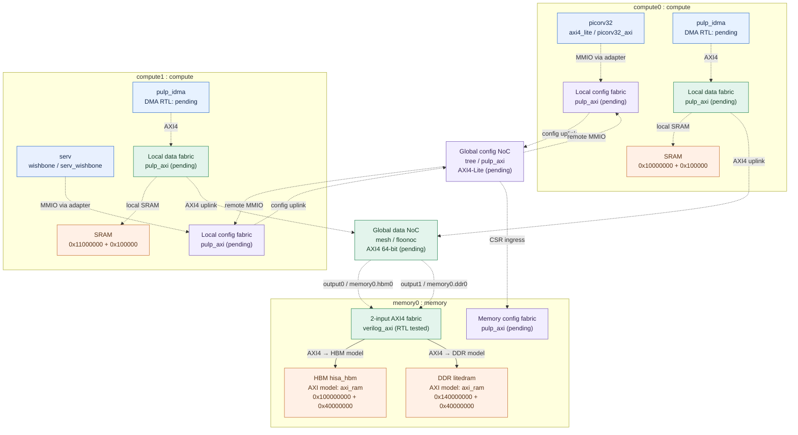
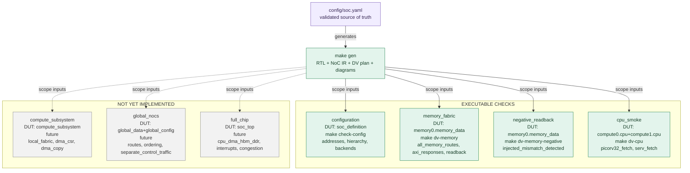

# Config-driven SoC RTL and verification with Xezim

[](https://github.com/r987r/xezim-hello-world/actions/workflows/dv-soc.yml)

A reusable, **configuration-driven hierarchical SoC test vehicle** built from publicly available RTL. One `config/soc.yaml` selects the compute subsystems, CPU and DMA IP, memory targets, data/config NoCs, addresses, and verification scopes. The same configuration generates **SystemVerilog testbench code, NoC connectivity metadata, executable test plans, 2D diagrams, and this README's architecture section**.

## Architecture, real RTL connectivity, and verification

<!-- BEGIN GENERATED SOC -->

<!-- Do not edit this section: regenerate with `make gen`. -->
### Architecture overview — configured intent

The diagram below shows **logical** chip connectivity. Dashed links are **planned, not integrated RTL**; solid memory-model paths are exercised in the memory testbench.



### Executable RTL connectivity — memory testbench

This is the wiring generated in `gen/memory/memory_tb.sv`: two AXI4 master BFMs, the real open-source AXI crossbar, two AXI memory models, and a passive route monitor. It is **not** a full-chip elaboration.

```mermaid
flowchart LR
  classDef cpu fill:#e8f0fe,stroke:#2869c9,color:#172a4b,stroke-width:1px;
  classDef dma fill:#e7f2ff,stroke:#2869c9,color:#172a4b,stroke-width:1px;
  classDef fabric fill:#e3f4ec,stroke:#20824e,color:#153c26,stroke-width:1px;
  classDef memory fill:#fff0e6,stroke:#c46b2f,color:#563115,stroke-width:1px;
  classDef config fill:#f1edff,stroke:#7654b5,color:#342451,stroke-width:1px;
  classDef verification fill:#e3f4ec,stroke:#20824e,color:#153c26,stroke-width:1px;
  classDef model fill:#f2f2f2,stroke:#888888,color:#333333,stroke-width:1px;
  subgraph TB["EXISTING RTL testbench: memory_tb"]
    direction LR
    ingress0["AXI master BFM 0<br/>64-bit / ID 4"]:::cpu
    ingress1["AXI master BFM 1<br/>64-bit / ID 4"]:::cpu
    xbar["verilog_axi axi_crossbar<br/>2 inputs × 2 outputs<br/>64-bit address, 64-bit data"]:::fabric
    memory0_hbm0["memory0.hbm0<br/>HBM simulation target<br/>axi_ram<br/>0x100000000 + 0x40000000"]:::memory
    memory0_ddr0["memory0.ddr0<br/>DDR simulation target<br/>axi_ram<br/>0x140000000 + 0x40000000"]:::memory
    route_monitor["AXI route monitor<br/>checks source/target and ID"]:::verification
  end
  ingress0 -->|AXI4 ingress 0 (AW,W,B,AR,R)| xbar
  ingress1 -->|AXI4 ingress 1 (AW,W,B,AR,R)| xbar
  xbar -->|AXI4 port 0 (AW,W,B,AR,R)| memory0_hbm0
  xbar -->|AXI4 port 1 (AW,W,B,AR,R)| memory0_ddr0
  xbar -.->|passive observation| route_monitor
  %% Only these connections are instantiated by gen/memory/memory_tb.sv.
```

### Hierarchical verification plan

Green scope boxes are **implemented testbenches**, not a claim that the entire SoC was simulated. Grey scope boxes are planned; CI separately determines whether executable scopes pass.



### Generated architecture reference

- **Subsystems:** 2 compute, 1 memory; **data:** AXI4 64-bit, 64-bit addressing; **config:** AXI4-Lite 32-bit.
- **Global data NoC:** floonoc / mesh (selected, emitter pending).
- **Global config NoC:** pulp_axi / tree (selected, emitter pending).
- **Local memory crossbar:** verilog_axi; 2 ingress × 2 targets (executable RTL testbench).

| Subsystem | CPU | CPU bus/adapter | DMA | Detailed 2D diagram |
| --- | --- | --- | --- | --- |
| `compute0` | `picorv32` | `axi4_lite` / `picorv32_axi` | `pulp_idma` (planned RTL integration) | [View](gen/diagrams/subsystems/compute0.md) |
| `compute1` | `serv` | `wishbone` / `serv_wishbone` | `pulp_idma` (planned RTL integration) | [View](gen/diagrams/subsystems/compute1.md) |

| Memory target | Kind | Selected controller | Simulated implementation | Global address window |
| --- | --- | --- | --- | --- |
| `memory0.hbm0` | HBM | `hisa_hbm` (not integrated) | `axi_ram` | `0x100000000` / `0x40000000` |
| `memory0.ddr0` | DDR | `litedram` (not integrated) | `axi_ram` | `0x140000000` / `0x40000000` |

| Configuration target | Base address | Size |
| --- | --- | --- |
| `compute0.dma` | `0x40000000` | `0x10000` |
| `compute1.dma` | `0x40010000` | `0x10000` |
| `memory0.hbm0` | `0x50000000` | `0x10000` |
| `memory0.ddr0` | `0x50010000` | `0x10000` |

| Global output | Configured target | Memory ingress |
| --- | --- | --- |
| `memory_ingress0` | `memory0.hbm0` | `0` |
| `memory_ingress1` | `memory0.ddr0` | `1` |

| Verification scope | Status | Entry point |
| --- | --- | --- |
| `configuration` | executable | `make check-config` |
| `memory_fabric` | executable | `make dv-memory` |
| `negative_readback` | executable | `make dv-memory-negative` |
| `cpu_smoke` | executable | `make dv-cpu` |
| `compute_subsystem` | planned | `not implemented` |
| `global_nocs` | planned | `not implemented` |
| `full_chip` | planned | `not implemented` |

**Explore generated artifacts:** [NoC intermediate representation](gen/noc/fabric_ir.json) · [RTL connection metadata](gen/diagrams/graphs.json) · [verification plan](gen/verification/plan.json) · [route matrix](gen/verification/routes.json) · [memory testbench](gen/memory/memory_tb.sv) · [generated manifest](gen/manifest.json).

**Detailed subsystem diagrams:** [compute0](gen/diagrams/subsystems/compute0.md) · [compute1](gen/diagrams/subsystems/compute1.md) · [memory0](gen/diagrams/subsystems/memory0.md).

<!-- END GENERATED SOC -->

## Reproducible generation

Everything under **[`gen/`](gen/)** is committed to Git for version-to-version diffs. The directory is exclusively generator-owned and contains a marker protecting against accidental replacement of user-owned trees.

```bash
python3 -m pip install 'PyYAML==6.0.3'
make gen                 # regenerate code, metadata, diagrams, README
make check-generated     # non-mutating drift and stale-file check
make check-config        # generator/config test suite
```

`make gen` builds all outputs in a staging directory before replacing the complete `gen/` tree. **Obsolete generated files are removed** when a block, network, subsystem, or diagram disappears from YAML. No file outside `gen/` is deleted; only the explicitly marked README section is rewritten. `make check-generated` compares both file *names* and bytes, so CI catches missing, modified, and stale files without committing or modifying anything. Generation does not depend on a GPU, web service, 3D viewer, or Graphviz: the README uses GitHub-native **2D Mermaid** diagrams.

The generated artifacts include:

| Output | Purpose |
| --- | --- |
| [`gen/memory/memory_tb.sv`](gen/memory/memory_tb.sv) | Real synthesizable crossbar instantiated in a generated AXI memory testbench |
| [`gen/memory/manifest.json`](gen/memory/manifest.json) | Bus parameters, instance metadata, memory models, tests |
| [`gen/noc/fabric_ir.json`](gen/noc/fabric_ir.json) | Vendor-neutral NoC/interconnect intermediate representation |
| [`gen/verification/plan.json`](gen/verification/plan.json) | Verification scopes, executable vs planned boundaries, test commands |
| [`gen/verification/routes.json`](gen/verification/routes.json) | Source/target AXI reachability expectations for the executable memory test |
| [`gen/diagrams/`](gen/diagrams/) | Source-controlled 2D diagrams (`.mmd`) and structured graph metadata (`graphs.json`) |
| [`gen/manifest.json`](gen/manifest.json) | Deterministic SHA-256 index of every generated output |

The 2D visualizations follow the instance/connection metadata ideas in [Sv-diagrams](https://github.com/r987r/Sv-diagrams) and [Diagram-gen](https://github.com/r987r/Diagram-gen); verification scope metadata follows the YAML testbench pattern in [Sv-test](https://github.com/r987r/Sv-test). There is **no 3D dependency** and no duplication of architecture definitions in the diagram sources.

## Running the verification checks

The regression reuses the pinned Xezim executable; it does **not** rebuild Rust or Xezim for source or configuration changes. Third-party RTL is fetched at locked commits on first use.

```bash
make gen
XEZIM_BIN=/path/to/xezim make dv-memory
XEZIM_BIN=/path/to/xezim make dv-memory-negative
XEZIM_BIN=/path/to/xezim make dv-cpu
XEZIM_BIN=/path/to/xezim make test
```

The memory regression instantiates the publicly available Verilog-AXI crossbar and behavioral AXI RAM. It issues four-beat reads and writes from two independent AXI masters to HBM0 and DDR0 address regions, then checks responses, IDs, data, and reachability. The negative test intentionally corrupts an expectation and confirms the checker rejects it. The CPU smoke checks instantiate actual PicoRV32 and SERV RTL and observe instruction fetches.

**Not yet implemented:** real PULP iDMA integration, full-chip CPU/data/config NoC wiring, FlooNoC or PULP AXI backend emission, and the physical HBM/DDR controller/PHY integration. Selected controller projects are research/integration candidates; the simulated `axi_ram` targets are **not timing-accurate HBM or DDR controllers**. The HBM candidate currently relies on vendor HBM PHY IP.

## IP replacement and implementation boundaries

- The **architecture** is specified by [`config/soc.yaml`](config/soc.yaml), including per-subsystem CPU differences and separate data/config networks.
- [`tools/socgen.py`](tools/socgen.py) emits the executable memory RTL and neutral NoC IR; [`tools/noc_backends.py`](tools/noc_backends.py) defines vendor-specific emitters. The **`verilog_axi` memory backend is executable**; PULP AXI and FlooNoC emitters are **not implemented yet** and are explicitly reported as such.
- [`tools/diagram_gen.py`](tools/diagram_gen.py) uses the same validated topology and verification scopes to render all 2D views; [`tools/generate.py`](tools/generate.py) coordinates generation, stale cleanup, and drift verification.
- [`config/ip.lock.yaml`](config/ip.lock.yaml) pins third-party IP commits. [`rtl/adapters/`](rtl/adapters/) isolates the CPU and behavioral memory interfaces.

See [architecture contracts](docs/architecture.md) and the [hierarchical verification plan](docs/verification.md) for intended subsystem, NoC, and full-chip integration milestones.

## Development and CI

GitHub Actions first validates the configuration, then checks the committed `gen/` tree and embedded README diagrams for drift, and only then runs the RTL regressions. A change to a configuration or generator must be followed by `make gen` in the same commit. An intentionally removed subsystem must result in a **Git deletion** of its obsolete generated files; it must never leave misleading diagrams behind.

The simulator publishing workflow is independent of the SoC verification workflow, so an RTL-only change never initiates a Rust build.
