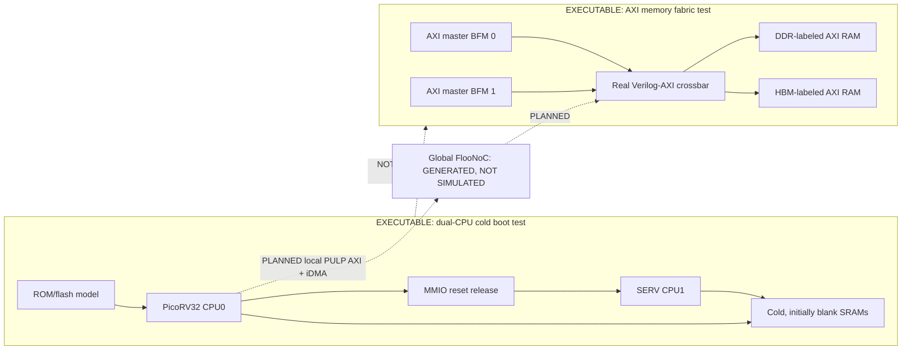

# Xezim implementation status and diagram index

This is a **scope-aware** inventory, not a declaration that the complete
SoC is integrated. The authoritative config is
[`config/soc.yaml`](../config/soc.yaml), the backend registry is
[`noc_backends.py`](../tools/noc_backends.py), and the generated
verification plan is [`plan.json`](../gen/verification/plan.json).
Check the latest [GitHub Actions runs](https://github.com/r987r/xezim-hello-world/actions/workflows/dv-soc.yml)
for the exact SHA before reporting regression results.

## What runs, versus what is only configured

| Part | Actual executable RTL scope | Limit |
| --- | --- | --- |
| Real `verilog-axi` AXI4 crossbar | `make dv-memory` with two master BFMs, HBM/DDR **behavioral AXI RAM** targets | No CPU/DMA or global NoC in this scope |
| Full/sparse native crossbar settings | `AXI_CONFIG=config/examples/memory-fabric-connectivity.yaml make dv-memory; AXI_CONFIG=config/examples/memory-fabric-sparse.yaml make dv-memory` | Examples are separate opt-in workloads, not the default full-chip topology |
| Negative memory checker | `make dv-memory-negative` | Demonstrates data corruption is caught |
| Local two-port SRAM model | `make dv-sram` | Custom test model, not a silicon SRAM macro |
| Real SERV instruction test | `make dv-serv` | Small standalone core+RAM test |
| Dual-CPU cold boot | `make dv-boot`: real PicoRV32 ROM fetch, flash reads, SRAM writes, SERV MMIO release, two signatures | Standalone bootstrap memory/bus model, not the generated full-chip NoC |
| PULP iDMA | **No executable subsystem** | Source commit only; frontend, CSR and data connections pending |
| Local FlooNoC | **Generated structural Verilog for all local data/config meshes** | CPU/DMA/CSR endpoint wiring, elaboration and traffic NOT yet integrated |
| Global FlooNoC mesh | **Upstream-generated structural Verilog tracked in gen/noc/floonoc/global_data** | Router/chimney modules generated; dependency elaboration and AXI traffic NOT demonstrated |
| Global config FlooNoC | **Generated structural AXI4 transport RTL** | Real PULP AXI-Lite boundary adapters and CSR transfers NOT yet connected |
| LiteDRAM / HiSA HBM | **No executable physical controller/PHY path** | Verification models are generic AXI RAM, not DDR/HBM controllers |
| End-to-end SOC `soc_top` | **No executable RTL** | CPU to DMA to NoC to memory not proven |

### Two separate working simulation islands

Solid lines within the two testbench boxes are tested at their *respective
scope* only; all dashed lines are plans. No HBM/DDR PHY behavior is implied.

## Generated diagrams: open all seven views

The `make gen` pipeline generates eight actual FlooGen network tops/packages, plus static SVG and Mermaid sources
from the same validated configuration. CI runs `make check-generated`
to require that all files, SVG images, graph metadata, and the generated
README section agree with source. **Never edit an SVG or `gen/` directly.**

| Diagram | GitHub-friendly rendered view | Editable source |
| --- | --- | --- |
| Logical SoC, planned versus actual | [Architecture SVG](../gen/diagrams/architecture.svg) | [Mermaid](../gen/diagrams/architecture.mmd) |
| Exactly instantiated AXI memory testbench | [RTL connectivity SVG](../gen/diagrams/rtl-connectivity.svg) | [Mermaid](../gen/diagrams/rtl-connectivity.mmd) |
| Boot flow | [Boot SVG](../gen/diagrams/boot.svg) | [Mermaid](../gen/diagrams/boot.mmd) |
| Verification scopes and maturity | [Verification SVG](../gen/diagrams/verification.svg) | [Mermaid](../gen/diagrams/verification.mmd) |
| Compute0 / PicoRV32 | [Compute0 SVG](../gen/diagrams/subsystems/compute0.svg) | [Mermaid](../gen/diagrams/subsystems/compute0.mmd) |
| Compute1 / SERV | [Compute1 SVG](../gen/diagrams/subsystems/compute1.svg) | [Mermaid](../gen/diagrams/subsystems/compute1.mmd) |
| Memory0 / two targets | [Memory0 SVG](../gen/diagrams/subsystems/memory0.svg) | [Mermaid](../gen/diagrams/subsystems/memory0.mmd) |

Also inspect generated [graph JSON](../gen/diagrams/graphs.json)
and [route matrix](../gen/verification/routes.json) to trace edges and
check which tested route was allowed. Architecture diagrams are **logical
intent** while the RTL-connectivity diagram is strictly the exercised
memory testbench.

## What would justify saying "FlooNoC works"?

At minimum: pinned FlooNoC and FlooGen sources, real generated router/
network-interface/link RTL compiled in the pinned Xezim simulator; connected
AXI endpoints with address and ID translation; traffic across *multiple
routers* to both memory targets; end-to-end data, ordering and reachability
checks plus negative/error cases and backpressure; and committed
`soc_top` source lists and matching *executable* topology diagrams.
None of this is established by just `backend: floonoc` or by the existing
Verilog-AXI crossbar test.

## No regressions hidden by the boot model

The Xezim 0.11.3 part-select workaround is removed. Pinned Xezim 0.11.4,
upstream SERV and the real CPU boot regression must continue\npassing. See [boot-debug](boot-debug.md) for timing and VCD details.
\n## Generated structural NoC RTL\n\nAll eight structural NoC SystemVerilog modules and packages are in [`gen/noc/floonoc`](../gen/noc/floonoc/), indexed by [manifest](../gen/noc/floonoc/manifest.json). These are upstream FlooGen output, **not** vendor RTL copied into the repository. Config FlooNoCs use AXI4 as the wire transport with planned upstream PULP AXI-Lite adapters (see [protocol reuse guide](axi-lite-over-floonoc.md)). The system currently has no integrated NoC traffic test.\n