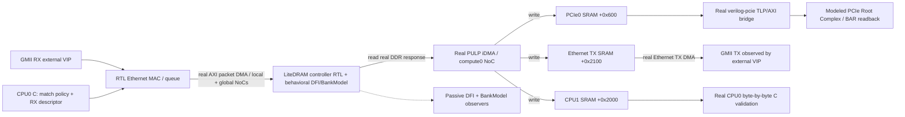

# Issue #34 — one-chip multiprotocol integration closure

**Functional milestone completed:** [PR #150](https://github.com/r987r/xezim-hello-world/pull/150) merged after the one-run `chip-ethernet-ddr-pcie` source-qualified [full-chip RTL/CPU/DFI/TLP/GMII CI](https://github.com/r987r/xezim-hello-world/actions/runs/42498075763) passed. Closed #34 covers **this bounded functional MVP only**. General directed/randomized transfer chaining remains [#158](https://github.com/r987r/xezim-hello-world/issues/158) on the reusable P0 [#152](https://github.com/r987r/xezim-hello-world/issues/152) action runtime. A plan, generated variant, or separately passed subsystem run is still not proof of a new flow.

## Exact SoC boundary (single elaboration and source revision)



There is exactly **one** CPU0 C firmware hook, one `full_chip_tb`,
one generated source-selected DDR NoC variant, and one run-wide six-source
protocol JSONL. Every transfer above is rejected if the actual accepted
AXI/DFI/TLP/GMII evidence is missing. The RX header is packet classification
input, **not** a programmable memory destination; the posted ring descriptor
owns the 64-bit physical DDR address.

## Coverage matrix — status is NOT inferred from separate passing suites

| User-directed flow | #34 composite coverage | Proof / missing work |
| --- | --- | --- |
| Ethernet RX -> host | **MVP PASS: host BAR pull only** | Same-run RX→real DDR→PULP iDMA→PCIe SRAM→Root Complex BAR readback; **not** chained endpoint DMA into host RAM (#158) |
| Ethernet RX -> HBM/SRAM | **Not yet** | Existing Ethernet SRAM path is separate. Real HBM controller is absent; do not equate modeled HBM SRAM with physical HBM |
| Ethernet RX -> real DDR | **MVP PASS** | One-run queue destination in >4 GiB DDR with accepted AXI B and real LiteDRAM RTL/behavioral DFI bank evidence |
| Host DMA -> Ethernet TX | **Not yet** | Would need independently host-seeded PCIe BAR -> iDMA -> real Ethernet TX and host handshake sequencing |
| DDR/SRAM -> Ethernet TX | **MVP PASS from real DDR** | iDMA DDR→TX SRAM→real GMII TX, byte/FCS check and B-gated CQ |
| DDR/SRAM -> host | **MVP PASS via host BAR pull** | Real DDR→PULP iDMA→PCIe SRAM→RC BAR read; standalone endpoint→host-RAM DMA passed separately in #149 but not chained to this ingress (#158) |
| DDR/SRAM -> DDR/SRAM | **MVP PASS for DDR→CPU1 SRAM; matrix incomplete** | Same-run DDR→CPU1 SRAM + Ethernet/PCIe staging; arbitrary memory-to-memory combinations remain #158 |
| Host write -> HBM/SRAM | **Not yet in this composite** | PCIe BAR write/read to PCIe SRAM occurs; next chain host BAR -> iDMA -> memory, no claim for real HBM |
| Host read <- HBM/SRAM | **MVP PASS for host BAR-pull of DDR-staged PCIe SRAM** | No direct host-read of HBM; standalone host-MRd/device-Cpl uses #149, different run |

The single hardware RX/TX queue is a hard limit. A sequence of transfers can
reuse the queue after CPU acknowledgements, but parallel multi-flow queue
randomization needs new queue scheduler / queue capacity RTL, not a fictitious
testbench control packet. Nothing in this test puts destination addresses in
the incoming Ethernet payload.

## Evidence and pass contract

1. Real CPU0 writes queue descriptor, classification policy and producer
   pointers via actual Config + Data NoCs. The test does not preload SRAM/DDR.
2. External `cocotbext-eth` injects exactly one 85-byte frame after firmware
   READY, then observes the hardware GMII TX frame byte-for-byte with good FCS.
3. CPU0 observes real RX/TX completion records and cookie/status, acknowledges
   IRQ; real `soc_dma_desc_t` chain retires all three writebacks with
   terminal sentinel and CPU compares bytes from CPU1 SRAM and TX SRAM.
4. Modeled PCIe Root Complex enumerates actual `verilog-pcie` TLP-AXI RTL,
   performs real BAR write/read checks, then independently reads the 85-byte
   DMA staging buffer and checks against the originally injected Ethernet
   frame. TLP source/end, matching request tag/completions and error statuses
   must be complete.
5. Passive `axi-events.jsonl` must show real Ethernet packet-DMA writes
   into DDR and PULP iDMA DDR reads / writes to all three physical targets,
   plus Ethernet descriptor fetch / TX payload fetch and CPU config/CQ.
6. DDR's pinned controller **must** have actual AXI AW/B/AR/R completion,
   positive DFI RD/WR and behavioral BankModel write observations. This is
   not a real PHY, physical DDR4 device, training, timing margin or full
   HBM RTL qualification.
7. `combined34_evidence.json` only materializes after the single live
   cocotb run, six-source protocol capture, all completed INIT/RUN/CHECK
   steps, independent scoreboard and explicit CPU/host PASS. It cannot
   overwrite a prior evidence artifact.

### Reproduce (pinned prerequisites)

```sh
python3 -m unittest tests.test_combined34 -v
python3 tools/regress.py chip-ethernet-ddr-pcie --stage files --fail-fast
python3 tools/regress.py chip-ethernet-ddr-pcie --stage build --fail-fast
python3 tools/regress.py chip-ethernet-ddr-pcie --stage run --fail-fast
```

Pinned upstream LiteDRAM, LiteX, FlooNoC, PULP iDMA, verilog-pcie, external
VIPs, clang/LLVM, and Verilator are installed by
`.github/workflows/dv-combined34.yml`. **A source filelist or successful
Verilator elaboration alone is not a regression PASS.**

The same CI retains `variant/manifest.json`, `firmware.json`,
`ddr_noc/`, `axi-events.jsonl`, `protocol-events.jsonl`,
`ddr4_dfi_events.jsonl`, `test-flow-events.jsonl`, `result.json`,
`report.html`, and `combined34_evidence.json`, if emitted.
Never publish an `unknown`/missing value as measured.

## Remaining closure gates / owners

- **#152 typed directed + randomized execution:** This first composite
  test has authored INIT/RUN/CHECK intent and real observed milestones,
  but the legacy C/Python runner is explicitly listed in
  `config/runtime_migration.yaml`. It is NOT an SCN-2-native action DAG.
  Next: a source-selected typed action contract, explicit actor
  dependencies, runtime action start/completion evidence and per-run
  randomized allocation/seed/replay. A test should execute the
  **same action dispatcher** for directed and randomized cases; sequence
  differences should come only from the selected plan. Avoid
  hard-coded/fixed seed semantics or fabricated completion events.
- **#46 structural audit:** close only when selected RTL chip variant has
  elaborated real source-to-target netlist bit paths and live traffic.
- **#43 low-latency direct path:** add the direct Ethernet/compute/PCIe
  route, separate from DDR-staged traffic, and prove its accepted AXI/TLP.
- **#35 DDR qualification:** keep storage model limitations explicit and
  validate adverse load, ordering and controller reset / errors.
- **#158 broader flow matrix:** one RX/one TX queue and sequential host/DDR
  combinations first; introduce multiple queues, arbitration and
  interleaved random transfers only after the queue RTL supports them.
  A CPU-visible event queue or hardware doorbell should own dependency
  triggering; Ethernet packets should not carry test control addresses.

The initial #34 MVP closed after the exact-head combined CI; **do not reopen it or count missing advanced paths as delivered**. Close individual #158 flow gates only with source-qualified, independently checked same-run artifacts. Preserve explicit separate ownership for #43, #46, #76 and #152.
