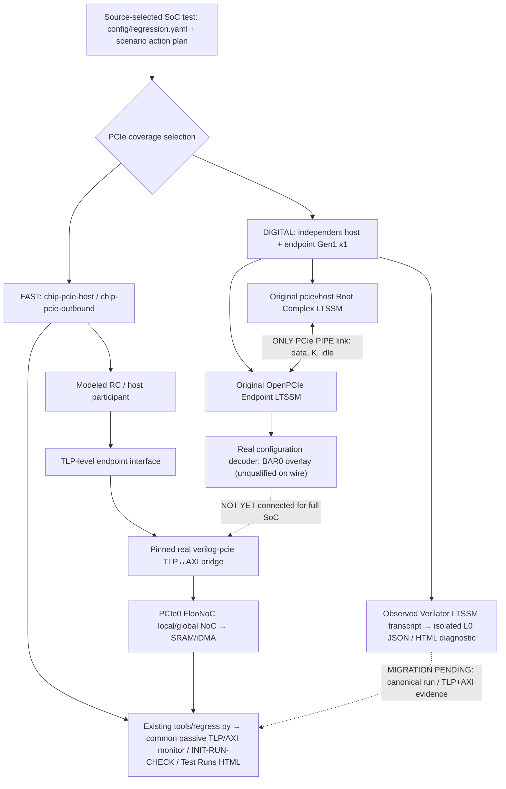
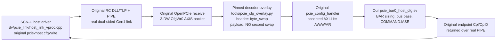

# PCIe verification modes, common stimulus and reporting

**Owner:** [PCIe P0 #76](https://github.com/r987r/xezim-hello-world/issues/76) ·
[Stimulus scaling #152](https://github.com/r987r/xezim-hello-world/issues/152) ·
[Draft real-link PR #225](https://github.com/r987r/xezim-hello-world/pull/225)

Two **complementary** backends remain selectable. Never replace the existing
TLP-level SoC regression with the much slower digital PIPE/LTSSM qualification,
and never count a TLP-only pass as a digital-link pass. This documentation
is the shared architecture; each actual run carries its own source, selected
configuration, capture inventory and independent results.

## One architectural view



**Physical interface:** active Gen1 x1 PIPE is **16 data bits + 2 K bits,
125 MHz** (the endpoint declares wider 32-bit HDL vectors, only 16 bits
active at Gen1). Original pcievhost's separate symbol clock runs at
250 MHz. Fast LTSSM mode shortens specified waits only; no LTSSM force
or host/device readiness backchannel is allowed.

## Mode and evidence matrix

| Function | Fast TLP-backed SoC regression | Digital link test |
| --- | --- | --- |
| Command | `python3 tools/regress.py chip-pcie-host` or `chip-pcie-outbound` | GitHub Actions `pcie-digital-link.yml` (current integration) |
| Runtime | Existing `dv/full_chip/test_boot.py` INIT/RUN/CHECK, `dv/pcie0/host_adapter.py` | One selected `pcie.link.train` INIT action, native host SCN-C callback; full runner adoption pending |
| Root Complex | Cocotb modeled RC with TLP-level connection | Original independent pcievhost VProc RC |
| Device | Real pinned TLP-to-AXI bridge, PCIe0 FlooNoC, SRAM and CPU0 C/iDMA | Original OpenPCIe endpoint with LTSSM/DLL/PIPE and device-local pre-link BAR setup |
| Link training | **Not present** | Independently observed host and endpoint L0 in CI run `43099695972` |
| Configuration space | Modeled host/endpoint BAR0 enumeration, real bridge TLPs | Host-visible BAR RTL overlay compiled; real host config TLP enumeration **not yet tested** |
| Memory traffic | Real AXI/TLP captures, RAM byte scoreboard | Not yet connected to real NoC/SRAM |
| Reporting | Existing canonical `result.json`, `test-flow.json`, `axi-transactions.json`, `protocol-transactions.json`, HTML | `pcie-link-evidence.json`, `pcie-link-report.html`, and reused `protocols.html` explorer for observed LTSSM events **only** |
| SerDes/electrical link | No | No: behavioral digital PHY only |
| Source selection | `config/regression.yaml`, `config/stimulus/tests.yaml` | Pinned `config/pcie_link.yaml`, single `config/scenarios/pcie-gen1-link.json`; same SCN schema |

The source-only `gen/pcie_link/selection.json` retains false capability
claims by design: source selection *never* creates a PASS. Real per-run L0
evidence is retained separately and must reference the executed source SHA.
Do not mutate the generated declaration to say `trained_l0:true`.

## Current reporting seam

`tools/pcie_link_report.py` is an **evidence-only renderer** of the exact
Verilator log: source lines for device prelink BAR commit, real receiver
detection, PIPE width, LTSSM transitions, independent endpoint L0, and host
`InitLink(1)` return, with an exact selected scenario plan SHA. It emits
`pcie-link-evidence.json` and `pcie-link-report.html` into the same CI
artifact as `pcie-cross-run.log`. It also calls the existing
`dv.common.protocol_trace.ProtocolTrace` and
`tools/protocol_report.py` to produce `protocol-events.jsonl`,
`protocol-transactions.json` and the existing interactive
`protocols.html` viewer containing **only observed endpoint LTSSM
state-transition events** with simulator timestamps. These are not
TLP transactions. On missing/duplicate or impossible
milestones, it rejects the L0 diagnostic. An event without a simulator
timestamp is rendered **unmeasured**, never assigned a fabricated time.

This renderer does **not** emit a `result.json`, full-chip `test-flow.json`,
completed TLP packet, AXI transaction or memory scoreboarding artifact.
Those are owned by `tools/regress.py`, `tools/test_flow_report.py`,
`tools/protocol_report.py`, `tools/axi_report.py` and
`tools/action_evidence.py`, which already serve our Test Runs/Pages viewer.
A dedicated link test must be integrated with that existing canonical
reporting lifecycle once it has passive real TLP + AXI/NoC evidence.
Do **not** create a second results website.

To reproduce the fast path and view measured traffic:

```sh
python3 tools/regress.py chip-pcie-host
python3 tools/regress.py chip-pcie-outbound
```

For the isolated digital-link evidence and negative tests:

```sh
python3 -m unittest tests.test_pcie_link_report -v
python3 tools/pcie_link_report.py pcie-cross-run.log --out .tools/pcie-link/observations
```

The digital-link Actions artifact contains the original simulator log,
source-selected scenario plan, JSON evidence, isolated HTML timeline, and
standard `protocols.html` passive protocol explorer. The established
`chip-pcie-host` and `chip-pcie-outbound` Test Runs reports remain
unchanged. Neither
this documentation nor the diagnostic is a full-chip PASS.

## Over-link BAR enumeration qualification — opt-in matrix

The dedicated PCIe workflow now uses a **single shared Verilator build recipe**
with two selectable canonical action plans. The `l0` lane executes
`config/scenarios/pcie-gen1-link.json` (one real host training action);
the `bar0` lane executes
`config/scenarios/pcie-gen1-bar0.json` (the same action plus dependent
`pcie.config.bar0`). This preserves an independent L0 regression even
if configuration TLP acceptance is broken.

The BAR0 action calls the pinned pcievhost `cfgWrite`/`cfgRead` APIs.
Its receive callback checks the **real returned completion TLP** against
the outstanding host tag and success status. It sends the standard BAR0
all-ones size probe, verifies the 4KiB mask, assigns host bus address
`0x80001000` (distinct from device SRAM `0x12000000`), reads it back,
writes COMMAND.MSE, then checks the readback. All operations time out
and fail on missing completions. At the other end, passive endpoint RX
and completion-TX AXI-stream handshakes are logged from original RTL.
No testbench relay or direct host/device prelink readback exists.

The `bar0` CI lane is **experimental/unqualified until its own run
passes**. Independent L0 is already established; it does not imply
the new config sequence succeeds. Once passed, add its correlation
to the canonical test-flow and TLP reporter. Full-chip BAR memory
transactions must still use pinned `pcie_axi_master` and FlooNoC.

## Byte-order ownership: do not hide a real decoder bug

This is a **boundary contract** for the original independently trained
pcievhost Root Complex and original OpenPCIe Endpoint, not a testbench
`byte_swap` workaround. Follow the complete real path:



**Where our code lives** (all are editable in PR #225):

- `dv/pcie_link/host_link_vproc.cpp` — source-selected host action
  `pcie.config.bar0`; invokes *original pcievhost* `cfgWrite`/`cfgRead`;
  checks returned tag/status/4-byte CplD and BAR0/MSE readback
- `dv/pcie_link/endpoint_prelink_ctrl.sv` — device-local BAR aperture,
  SRAM target, commit and LTSSM release policy (testbench stand-in for
  real CPU0/Config-NoC programming, **not** visible to host software)
- `dv/pcie_link/pcie_bar0_host_cfg.sv` — BAR0 size-mask/assignment
  and COMMAND.MSE semantics from *accepted* original configuration
  AXI-Lite AW/W/AR handshakes; no manually injected TLP values
- `tools/pcie_cfg_overlay.py` — source-hash-checked modifications to
  the pinned original `pcie_config_decode.sv` and
  `pcie_cfg_wrapper.sv`; applies only to the external checkout
  during simulation, so the OpenPCIe provider remains replaceable
- `dv/pcie_link/tb_pcie_cross_link.sv` — independent concurrent host
  and EP physical-link wiring + **passive** monitors
- `tools/pcie_bar0_evidence.py` — compares original RC TX payload,
  original endpoint RX last beat, **accepted** AXI WDATA, returned
  endpoint CplD payload and the original RC completion callback;
  refuses a PASS if any of these observations disagree

**Root cause 1 (fixed):** pinned `pcie_config_decode.sv` decoded
`TLP_4DW_ND` as having a payload but failed to decode `TLP_3DW_WD`,
so real ConfigWr0 `FFFFFFFF` was dropped. Its `ST_TLP_SEND` also
explicitly output zeros for payload and strobe. The pinned overlay now
captures a genuine skid-buffer-accepted payload and holds it through
ready/valid. Run 43130625842 proved the original host's actual
`FFFFFFFF` BAR0 probe and `FFFFF000` readback over the link.

**Root cause 2 (fixed):** the original decoder byte-swapped every
32-bit header DWORD into its internal TLP header representation.
It then incorrectly applied the **same transformation to payload
DW0**, changing the root-complex bus assignment
`0x80001000` to `0x00100080`. The original endpoint TLP RX
had already presented `0x80001000` as its accepted data DWORD.
The source-backed overlay keeps the header conversion unchanged,
and forwards this already host-ordered payload through to AXI
**without a second swap**. No host expected value is modified.
Run 43131157735 independently observed host TX `0x80001000`,
EP RX `0x80001000`, AXI WDATA `0x80001000`, CplD returned
`0x80001000`, and COMMAND.MSE `0x00000002`, plus all six
successfully returned original completion TLPs.

Byte ordering depends on the streaming boundary, not a global
`endian` switch. For example, Altera's P-Tile Avalon-ST PCIe
guide explicitly specifies **header byte 0 in the most significant
byte** of a DWORD but **payload byte 0 in the least significant byte**.
Other vendor AXI streaming interfaces can have different conventions,
so the actual pinned OpenPCIe/pciemodel stream and reciprocal packet
capture remain authoritative for this test:

- https://docs.altera.com/r/docs/683059/26.1.1/p-tile-avalon-streamingip-for-pci-express-user-guide/tlp-header-and-data-alignment-for-the-avalon-st-rx-and-tx-interfaces
- https://docs.amd.com/r/en-US/pg054-7series-pcie/TLP-Format-in-the-AXI4-Stream-Interface

**Do not equate this proof with full SoC acceptance.** The physically
connected *BAR configuration* sequence has now passed in the actual
Verilator transcript, but run 43131157735 remained red because
`tools/pcie_link_report.py` rejected a later real LTSSM state change.
The pinned OpenPCIe state enum defines **0x005 = ST_L0**;
`link_up_o` can assert earlier while still in
`ST_CONFIGURATION_IDLE` (0x0e3). The evidence gate now requires
actual `ST_L0`, rejects a subsequent exit into Recovery, and the
L0-only host runs enough independent idle clocks for this state
transition (no device readiness backchannel).

Still unqualified: original upstream standalone Cocotb test has a
separate TS2/link-lane expectation mismatch; partial byte enables,
multi-DWORD data and unknown TLP types are not covered by this
1-DWORD BAR config directed sequence. The real endpoint non-config
memory TLP → FlooNoC → SRAM, full-chip CPU0 boot, and the canonical
full-chip traffic/byte scoreboards remain separate P0 gates.

## Independent Gen1 Data Link InitFC qualification

A genuine host `InitFC1/InitFC2` handshake passes when original pcievhost
Gen1 scrambling is enabled, matching OpenPCIe's active descrambler.
**Both** real-link CI lanes now enable this original host PHY behavior.
The previous L0-only smoke disabled scrambling and returned immediately
after `link_up_o` while the endpoint was still in Configuration.Idle;
when the simulation continued, it entered Recovery rather than true
`ST_L0 (0x005)`. Our new fail-closed reporter exposed that issue.
The host independently sends a fixed extra idle interval and both
real-link modes must observe the genuine endpoint `0x005` state. This
does not read any device readiness flag or force an LTSSM state.
Normal scrambling is not a byte-swap fix and does not alter BAR data.
PCIe PHY documentation identifies no-scrambling as a diagnostic mode,
not for an operating link:
https://docs.amd.com/r/en-US/pg054-7series-pcie/Advanced-Physical-Layer

No TS1/TS2, DLLP, FC credit, L0 or configuration completion is fabricated.

The initial real host ConfigWr0 BAR0 probe received a successful completion
on [CI run 43123758732](https://github.com/r987r/xezim-hello-world/actions/runs/43123758732).
The following CfgRd0 was blocked by pcievhost's **real fatal Data FC invariant**:
`NewFC=4160 OldFC=65`. Its 12-bit received credit wrapped after a
smaller advertised credit (64) followed a previously tracked 65, making
the delta exceed the permitted 2047. Do **not** disable the host's FC
sanity check, update received credit counters from TB software, or mark
the BAR0 read/probe qualified.

The pinned upstream `pcie_flow_ctrl_init.sv` sends a hardcoded minimum
credit `UpdateFC` after InitFC2. The separate upstream
`dllp_fc_update.sv` is already the actual dynamic UpdateFC producer.
The reviewed source-selected endpoint overlay changes the InitFC2-complete
transition from `ST_UPDATE_P` to `ST_FC_COMPLETE`: retain full
genuine InitFC1/InitFC2 exchange, then leave subsequent UpdateFC to its
existing dynamic owner rather than replaying fixed startup credits.
This is an **experimental real RTL bug fix**, not yet qualified until
the exact-head `bar0` and original upstream unit jobs execute successfully.
All patch bytes and SHA remain tracked in `gen/pcie_link/selection.json`.

## Still required for issue #76

1. Host original VProc API must issue **real ConfigRd0/ConfigWr0** after
   independent L0, probe and assign BAR0, set COMMAND.MSE/BME, and compare
   completions returned over PIPE. The host must not read device-local BAR
   setup state or CPU0 register values from the testbench.
2. Endpoint BAR0 source of truth must be SystemRDL/PeakRDL-backed and actually
   accepted by the configuration TLP/AXI-Lite path, not only an overlay
   receiving writes while the original register block rejects them.
3. After real enumeration, connect non-config TLP to the existing
   `verilog-pcie` bridge → PCIe0 FlooNoC → SRAM. Check actual writes,
   read completions, ordering, bytes, and host-side BAR relocation.
4. Replace the *local prelink TB surrogate* with CPU0's real firmware
   and Config NoC. Host link startup and device firmware boot run in
   parallel. CPU0 must program and commit device BAR capability before
   enabling endpoint LTSSM; host may train independently.
5. Add link-down/retrain, missing partner, corrupt TS2 and reset-race
   negative scenarios, preserving actual host/EP protocol boundaries.
6. Move the digital-link target into the existing canonical runner,
   catalog, passive monitor registry, report publisher and scenario seed
   matrix with correct per-actor independent phases and source correlation.
   Do not label it `scenario_native` or full-chip verified before that is true.

## Standalone upstream Cocotb qualification is separate

The original OpenPCIe UVM self-test uses a hardcoded 25 µs timeout,
too short for its normal 12 ms Detect.Quiet state. An independently
pinned **test-only** overlay
[`tools/pcie_upstream_test_timing.py`](../tools/pcie_upstream_test_timing.py)
makes the original FuseSoC `sim` target explicitly compile
`-GSIM_FAST_LINK=1` and extends the UVM test budget to 250 µs. This
is source-hash-checked and archived as an upstream source diff;
it does **not** force a link-up state, alter synthesizable defaults, or
claim cross-provider BAR/TLP/AXI acceptance. A real nonempty Cocotb
completed-test table remains mandatory. Until exact-head CI demonstrates
this upstream PASS, issue #76 and PR #225 remain open/draft.

**Policy:** default regular regressions keep their existing fast modeled
TLP provider. Real digital link is explicit/opt-in and adds coverage; never
delete or weaken the proven bridge-only path.

## P0 memory-window completeness and standalone upstream stall

The previously working BAR address translation seam is *not* an inbound
transaction bridge. At this checkpoint `pcie_bar0_noc_translate` receives an
explicit full `request_bytes_i` byte-span and accepts a request only if its
**entire** range lies within the precommitted, power-of-two BAR window and the
local 32-bit target. Arithmetic is widened to reject overflow; host-assigned
BAR and device-local target must both be aperture-aligned. The directed RTL
regression also rejects straddling reads/writes, zero-length transfers,
misaligned windows and traffic while memory readiness is false. The translator
does not create AXI handshakes, completion TLPs or a scoreboard; a real
non-config endpoint stream and pinned AXI bridge are still required.

The **separate** upstream OpenPCIe Cocotb self-test is red even though the
original RC↔EP Gen1 L0 and six BAR0 configuration TLPs pass independently.
Run [43153358261](https://github.com/r987r/xezim-hello-world/actions/runs/43153358261)
reproduced a memory timeout at 22-byte BAR write, offset 1, after hundreds of
successful test iterations. The original timeout snapshot shows true L0,
initialized FC, `s_tlp_axis_tvalid=0`, `s_tlp_axis_tready=1`,
`m_tlp_axis_tvalid=0`, and `m_tlp_axis_tready=1`. Thus the endpoint's
external AXIS interface was not permanently stalled at *that instant*; whether
the transaction was never scheduled by the original UVM/RC driver, lost inside
its packet path, or throttled by flow-control needs a full packet trace.

A new source-hash-locked **standalone-test-only** diagnostic records
`PCIE_UPSTREAM_RC_TX_BEGIN/DONE` when the original UVM RC schedules the late
BAR stress TLPs, and prints the original endpoint's AXIS/FC snapshot if
the original 10-us posted-write flush times out. The exception is re-raised
unchanged. No DLLP credits, host TLP, endpoint LTSSM, return data or check
expectations are synthesized or weakened. Keep this upstream self-test RED
until the actual packet/credit owner is identified and fixed. These
instrumentation changes are not a successful rerun by themselves.

## Host BAR0 relocation over the real PCIe bridge and NoC (fast mode only)

A second opt-in `dv/pcie0/run_noc_smoke.py` Verilator build now uses a
*modeled-TLP Root Complex* with 4KiB host BAR0 at 0x80001000. The original
pinned `pcie_axi_master` produces 64-bit AXI AW/AR addresses and real
completions; full AW/AR burst spans are checked with the same
`pcie_bar0_noc_translate` contract, while write-data W beats are gated until
an authorized AW handshake has been registered. The grant count tracks
simultaneous later AW/WLAST handshakes without an AWREADY-to-WVALID
combinational dependency. Addresses are relocated to 0x12000000 and routed over
the generated PCIe0 FlooNoC to actual SRAM. The existing direct BAR mode runs
unchanged first. The new case checks byte readback and an exact-window-edge
vector. Illegal requests fatal this fixture; no completion is forged.

This adds real TLP->AXI->NoC relocation coverage, **not** a completed
physical cross-provider OpenPCIe/pcievhost data path. The selected digital
link's non-config m_tlp_axis and s_tlp_axis still require a packet-width
adapter into this pinned bridge, genuine return completions, host/device
parallel boot sequencing and canonical passive TLP/AXI reports.
