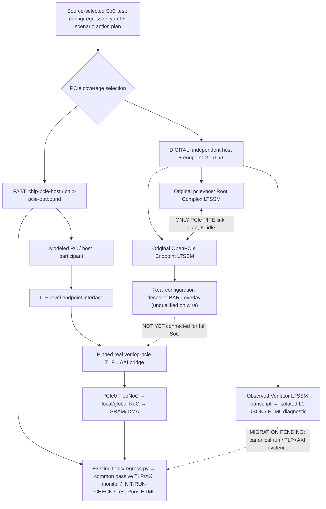

# PCIe verification modes, common stimulus and reporting

**Owner:** [PCIe P0 #76](https://github.com/r987r/xezim-hello-world/issues/76) ·
[Stimulus scaling #152](https://github.com/r987r/xezim-hello-world/issues/152) ·
[Draft real-link PR #225](https://github.com/r987r/xezim-hello-world/pull/225)

Two **complementary** backends remain selectable. Never replace the existing
TLP-level SoC regression with the much slower digital PIPE/LTSSM qualification,
and never count a TLP-only pass as a digital-link pass. This documentation
is the shared architecture; each actual run carries its own source, selected
configuration, capture inventory and independent results.

## One architectural view



**Physical interface:** active Gen1 x1 PIPE is **16 data bits + 2 K bits,
125 MHz** (the endpoint declares wider 32-bit HDL vectors, only 16 bits
active at Gen1). Original pcievhost's separate symbol clock runs at
250 MHz. Fast LTSSM mode shortens specified waits only; no LTSSM force
or host/device readiness backchannel is allowed.

## Mode and evidence matrix

| Function | Fast TLP-backed SoC regression | Digital link test |
| --- | --- | --- |
| Command | `python3 tools/regress.py chip-pcie-host` or `chip-pcie-outbound` | GitHub Actions `pcie-digital-link.yml` (current integration) |
| Runtime | Existing `dv/full_chip/test_boot.py` INIT/RUN/CHECK, `dv/pcie0/host_adapter.py` | One selected `pcie.link.train` INIT action, native host SCN-C callback; full runner adoption pending |
| Root Complex | Cocotb modeled RC with TLP-level connection | Original independent pcievhost VProc RC |
| Device | Real pinned TLP-to-AXI bridge, PCIe0 FlooNoC, SRAM and CPU0 C/iDMA | Original OpenPCIe endpoint with LTSSM/DLL/PIPE and device-local pre-link BAR setup |
| Link training | **Not present** | Independently observed host and endpoint L0 in CI run `43099695972` |
| Configuration space | Modeled host/endpoint BAR0 enumeration, real bridge TLPs | Host-visible BAR RTL overlay compiled; real host config TLP enumeration **not yet tested** |
| Memory traffic | Real AXI/TLP captures, RAM byte scoreboard | Not yet connected to real NoC/SRAM |
| Reporting | Existing canonical `result.json`, `test-flow.json`, `axi-transactions.json`, `protocol-transactions.json`, HTML | `pcie-link-evidence.json`, `pcie-link-report.html`, and reused `protocols.html` explorer for observed LTSSM events **only** |
| SerDes/electrical link | No | No: behavioral digital PHY only |
| Source selection | `config/regression.yaml`, `config/stimulus/tests.yaml` | Pinned `config/pcie_link.yaml`, single `config/scenarios/pcie-gen1-link.json`; same SCN schema |

The source-only `gen/pcie_link/selection.json` retains false capability
claims by design: source selection *never* creates a PASS. Real per-run L0
evidence is retained separately and must reference the executed source SHA.
Do not mutate the generated declaration to say `trained_l0:true`.

## Current reporting seam

`tools/pcie_link_report.py` is an **evidence-only renderer** of the exact
Verilator log: source lines for device prelink BAR commit, real receiver
detection, PIPE width, LTSSM transitions, independent endpoint L0, and host
`InitLink(1)` return, with an exact selected scenario plan SHA. It emits
`pcie-link-evidence.json` and `pcie-link-report.html` into the same CI
artifact as `pcie-cross-run.log`. It also calls the existing
`dv.common.protocol_trace.ProtocolTrace` and
`tools/protocol_report.py` to produce `protocol-events.jsonl`,
`protocol-transactions.json` and the existing interactive
`protocols.html` viewer containing **only observed endpoint LTSSM
state-transition events** with simulator timestamps. These are not
TLP transactions. On missing/duplicate or impossible
milestones, it rejects the L0 diagnostic. An event without a simulator
timestamp is rendered **unmeasured**, never assigned a fabricated time.

This renderer does **not** emit a `result.json`, full-chip `test-flow.json`,
completed TLP packet, AXI transaction or memory scoreboarding artifact.
Those are owned by `tools/regress.py`, `tools/test_flow_report.py`,
`tools/protocol_report.py`, `tools/axi_report.py` and
`tools/action_evidence.py`, which already serve our Test Runs/Pages viewer.
A dedicated link test must be integrated with that existing canonical
reporting lifecycle once it has passive real TLP + AXI/NoC evidence.
Do **not** create a second results website.

To reproduce the fast path and view measured traffic:

```sh
python3 tools/regress.py chip-pcie-host
python3 tools/regress.py chip-pcie-outbound
```

For the isolated digital-link evidence and negative tests:

```sh
python3 -m unittest tests.test_pcie_link_report -v
python3 tools/pcie_link_report.py pcie-cross-run.log --out .tools/pcie-link/observations
```

The digital-link Actions artifact contains the original simulator log,
source-selected scenario plan, JSON evidence, isolated HTML timeline, and
standard `protocols.html` passive protocol explorer. The established
`chip-pcie-host` and `chip-pcie-outbound` Test Runs reports remain
unchanged. Neither
this documentation nor the diagnostic is a full-chip PASS.

## Still required for issue #76

1. Host original VProc API must issue **real ConfigRd0/ConfigWr0** after
   independent L0, probe and assign BAR0, set COMMAND.MSE/BME, and compare
   completions returned over PIPE. The host must not read device-local BAR
   setup state or CPU0 register values from the testbench.
2. Endpoint BAR0 source of truth must be SystemRDL/PeakRDL-backed and actually
   accepted by the configuration TLP/AXI-Lite path, not only an overlay
   receiving writes while the original register block rejects them.
3. After real enumeration, connect non-config TLP to the existing
   `verilog-pcie` bridge → PCIe0 FlooNoC → SRAM. Check actual writes,
   read completions, ordering, bytes, and host-side BAR relocation.
4. Replace the *local prelink TB surrogate* with CPU0's real firmware
   and Config NoC. Host link startup and device firmware boot run in
   parallel. CPU0 must program and commit device BAR capability before
   enabling endpoint LTSSM; host may train independently.
5. Add link-down/retrain, missing partner, corrupt TS2 and reset-race
   negative scenarios, preserving actual host/EP protocol boundaries.
6. Move the digital-link target into the existing canonical runner,
   catalog, passive monitor registry, report publisher and scenario seed
   matrix with correct per-actor independent phases and source correlation.
   Do not label it `scenario_native` or full-chip verified before that is true.

**Policy:** default regular regressions keep their existing fast modeled
TLP provider. Real digital link is explicit/opt-in and adds coverage; never
delete or weaken the proven bridge-only path.
