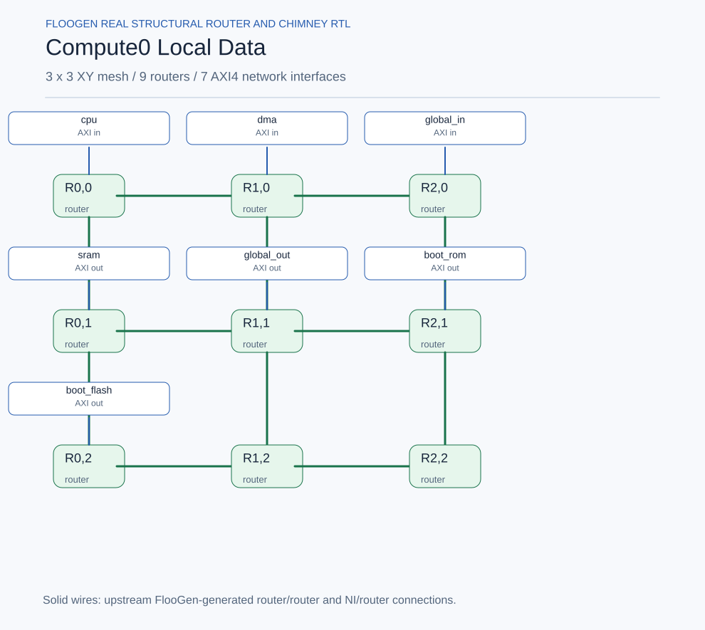

# Noc / Compute0_Local_Data

Generated from the actual upstream FlooGen configuration and manifest. **Inter-network wiring is planned; internal router links are generated RTL.**

[Mermaid source](compute0_local_data.mmd)
