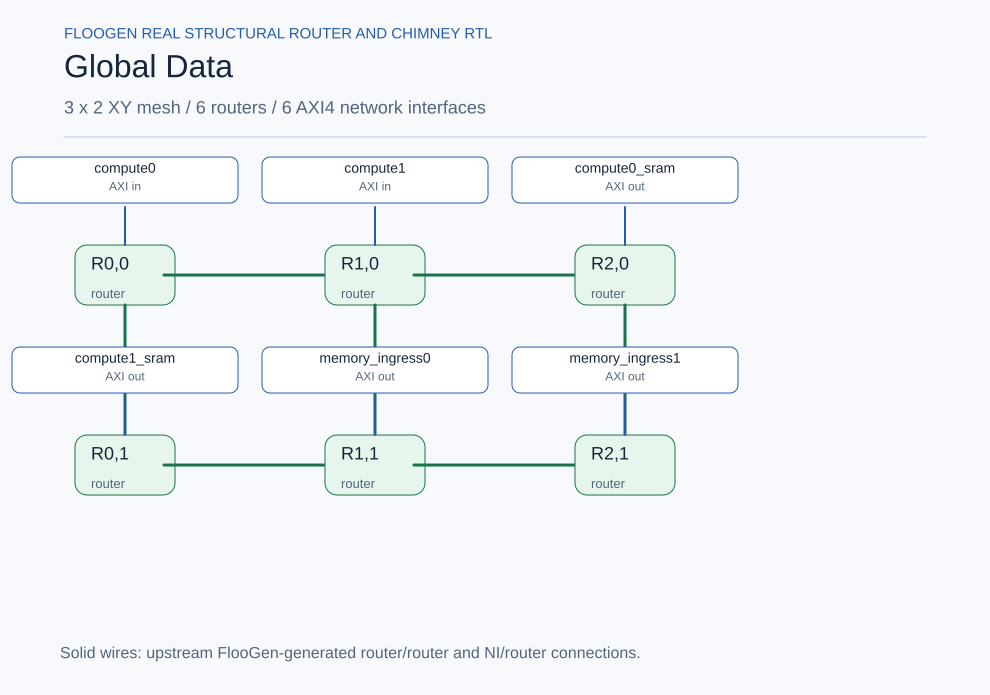

# Noc / Global_Data

Generated from the actual upstream FlooGen configuration and manifest. **Inter-network wiring is planned; internal router links are generated RTL.**

[Mermaid source](global_data.mmd)
