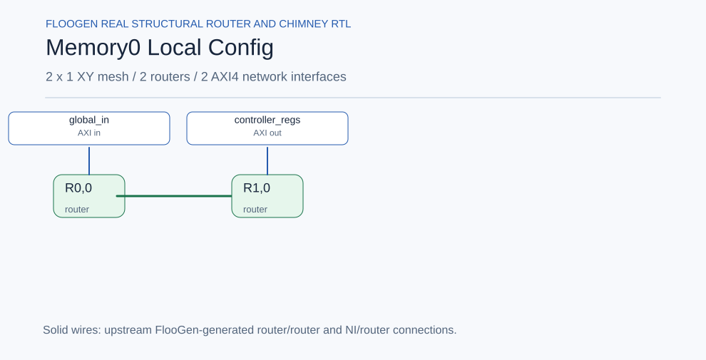

# Noc / Memory0_Local_Config

Generated from the actual upstream FlooGen configuration and manifest. **Inter-network wiring is planned; internal router links are generated RTL.**

[Mermaid source](memory0_local_config.mmd)
